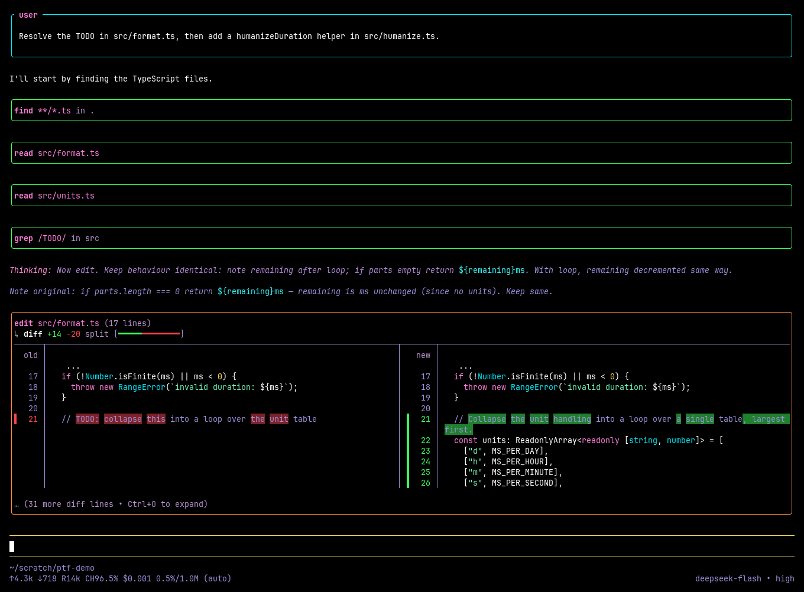
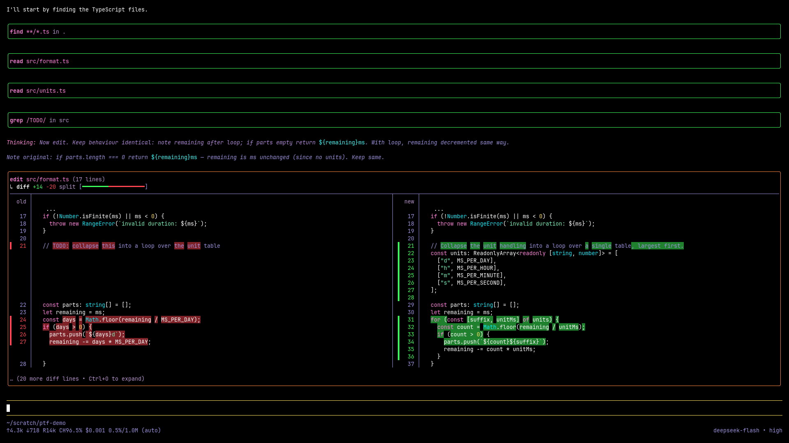
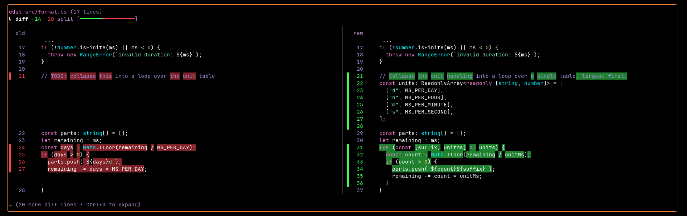
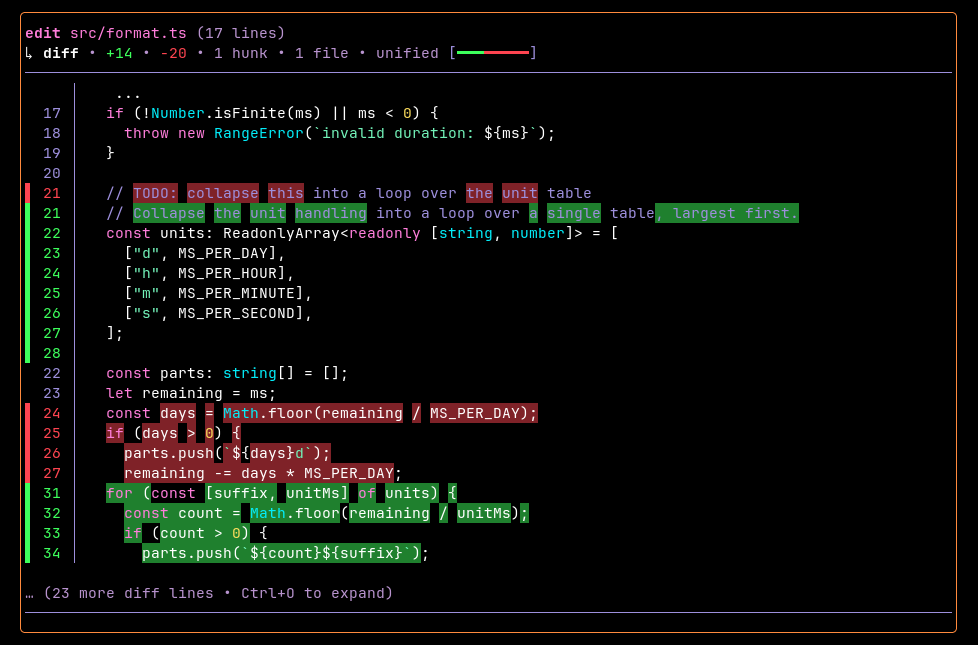
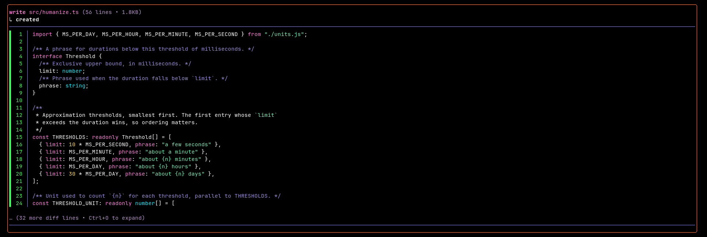

<div align="center">

# pi-tool-frame

OpenCode-style tool rendering for the [Pi coding agent](https://github.com/earendil-works/pi).

A hard fork of [MasuRii/pi-tool-display](https://github.com/MasuRii/pi-tool-display) 0.5.0, adding outline tool panels, theme-token or hex border colors, transparent diff rows and a theme-colored working spinner. The `/tool-display` command, the `extensions/pi-tool-display/config.json` path and the `pi-tool-display.*` API symbols are unchanged, so existing configs and renderer consumers keep working.

`pi-tool-frame` keeps tool calls compact by default, adds richer diff rendering for file edits, and improves a few core chat UI details such as thinking labels and the native user prompt box.



</div>

The screenshots use `toolPanelStyle: "outline"`, `diffPanelBorderColor: "#ff8a3d"` and `diffRowBackground: "transparent"` on a synthwave dark theme; everything else is the default `opencode` preset, except that the first image raises `diffCollapsedLines` to 14 to fit the frame.

<details>
<summary>More screenshots</summary>









</details>

## Features

- **Compact built-in tool rendering** for `read`, `grep`, `find`, `ls`, `bash`, `edit`, and `write`
- **MCP-aware rendering** with hidden, summary, and preview modes
- **Opt-in custom tool overrides** for noisy extension tools, defaulting to generic rendering unless `kind: "mcp"` is selected
- **Adaptive edit/write diffs** with split or unified layouts, syntax highlighting, inline emphasis, and narrow-pane width clamping
- **Workspace-scoped projected pending edit/write previews** that show `pending edit`, `pending overwrite`, and `pending create` diffs while partial tool calls are still streaming
- **Progressive collapsed diff hints** that shorten automatically on small terminal widths instead of overflowing
- **Hashline-anchor diff gutters** that preserve `LINE#HASH` labels from anchored read/edit output when those lines are rendered in diffs
- **Three presets**: `opencode`, `balanced`, and `verbose`
- **Thinking labels** during streaming and final message rendering, with context sanitization to avoid leaking presentation labels back into future model turns
- **Optional native user message box** with markdown-aware rendering and safer ANSI/background handling
- **Per-tool ownership toggles** so this extension can coexist with other renderer extensions
- **Capability-aware settings** that keep MCP and RTK-specific controls aligned with the current environment
- **Adapter API for renderer consumers** through the `pi-tool-frame/tool-display-api-consumer` subpath export
- **Outline tool panels** with state-colored or theme-token borders instead of tinted fills
- **Theme-colored working spinner** through any color token the active theme defines

## Installation

### Local extension folder

Place this folder in one of Pi's auto-discovery locations:

```text
# Global default (when PI_CODING_AGENT_DIR is unset)
~/.pi/agent/extensions/pi-tool-frame

# Project-specific
.pi/extensions/pi-tool-frame
```

### Git repository

```bash
# Latest main
pi install git:github.com/jsandai/pi-tool-frame

# Pinned release
pi install git:github.com/jsandai/pi-tool-frame@v0.6.0
```

`v0.6.0` predates hex color support for `toolPanelBorderColor`, `diffPanelBorderColor` and `workingIndicatorColor` (see `[Unreleased]` in the changelog); install from `main` to use `#rgb`/`#rrggbb` values.

## Usage

### Interactive settings

Open the settings modal:

```text
/tool-display
```

The modal exposes the day-to-day controls most people change regularly:

- preset profile
- read output mode
- grep/find/ls output mode
- MCP output mode (when MCP is available)
- preview line count
- bash collapsed line count
- diff layout mode
- diff indicators
- native user message box toggle
- tool panel style (`filled` or `outline`)

Advanced options remain in `config.json`.

### Direct commands

```text
/tool-display show                    # Show the effective config summary
/tool-display reset                   # Reset to the default opencode preset
/tool-display preset opencode         # Apply opencode preset
/tool-display preset balanced         # Apply balanced preset
/tool-display preset verbose          # Apply verbose preset
```

Applying a preset, from the modal or with `reset`/`preset`, replaces the whole saved config with that preset's values. Settings that are not part of the preset table (`toolPanelStyle`, the border and spinner colors, `diffRowBackground`, `customToolOverrides`, `registerToolOverrides`) go back to their defaults, so re-add them to `config.json` afterwards.

### Tool display adapter API

Other extensions can opt into this extension's rendering without directly depending on its load order by importing the consumer helper:

```ts
import { decorateToolForDisplay, decorateMcpToolForDisplay } from "pi-tool-frame/tool-display-api-consumer";
```

The helper talks to the runtime through the unchanged `pi-tool-display.api.v1` global symbol. `decorateToolForDisplay(tool, adapter)` applies the runtime decoration immediately when the extension is loaded, or queues the decoration until the API becomes available. Use adapter options such as `kind: "read" | "edit" | "mcp" | "generic"` to select the renderer family; `decorateMcpToolForDisplay(tool)` is the shortcut for MCP-style tools.

## Presets

| Preset | Read Output | Search Output | MCP Output | Bash Output | Preview Lines | Bash Lines |
|--------|-------------|---------------|------------|--------------|---------------|------------|
| `opencode` | hidden | hidden | hidden | opencode | 8 | 10 |
| `balanced` | summary | count | summary | summary | 8 | 10 |
| `verbose` | preview | preview | preview | preview | 12 | 20 |

- **`opencode`** (default): minimal inline-only display; tool results stay collapsed
- **`balanced`**: compact summaries with line counts and match totals; bash shows line count only
- **`verbose`**: larger previews for read/search/MCP/bash output

### Bash Output Modes

| Mode | Behavior |
|------|----------|
| `opencode` | Classic collapsed output using `bashCollapsedLines` limit with expansion hint |
| `summary` | Shows only line count (e.g., "↳ 3 lines returned") — no output displayed |
| `preview` | Shows actual output lines using `previewLines` limit |

## Configuration

Runtime configuration is stored at:

```text
Default global path: ~/.pi/agent/extensions/pi-tool-display/config.json
Actual global path: $PI_CODING_AGENT_DIR/extensions/pi-tool-display/config.json when PI_CODING_AGENT_DIR is set
```

A starter template is included at `config/config.example.json`.

### Configuration options

| Option | Type | Default | Description |
|--------|------|---------|-------------|
| `enabled` | boolean | `true` | Master switch; `false` skips every override, patch and the `/tool-display` command on the next start or `/reload` |
| `registerToolOverrides` | object | all `true` | Built-in tool ownership flags |
| `customToolOverrides` | object | `{}` | Explicit opt-in rendering rules for non-built-in extension tools |
| `enableNativeUserMessageBox` | boolean | `true` | Enable bordered user prompt rendering |
| `toolPanelStyle` | string | `"filled"` | `filled` (native tinted background) or `outline` (state-colored border, no fill) |
| `toolPanelBorderColor` | string | unset | Theme color token or `#rgb`/`#rrggbb` for every outline border, overriding the state colors |
| `diffPanelBorderColor` | string | unset | Theme color token or `#rgb`/`#rrggbb` for the outline border of finished `edit`/`write` panels |
| `workingIndicatorColor` | string | unset | Theme color token or `#rgb`/`#rrggbb` for the working spinner (pi uses `accent`); a token the theme lacks falls back to the default spinner |
| `readOutputMode` | string | `"hidden"` | `hidden`, `summary`, or `preview` |
| `searchOutputMode` | string | `"hidden"` | `hidden`, `count`, or `preview` |
| `mcpOutputMode` | string | `"hidden"` | `hidden`, `summary`, or `preview` |
| `previewLines` | number | `8` | Lines shown in collapsed preview mode (1-80) |
| `expandedPreviewMaxLines` | number | `4000` | Max preview lines when fully expanded, also caps expanded diffs (0-20000) |
| `bashOutputMode` | string | `"opencode"` | `opencode` (collapse), `summary` (line count), or `preview` (show lines) |
| `bashCollapsedLines` | number | `10` | Lines shown for collapsed bash output (opencode mode) (0-80) |
| `diffViewMode` | string | `"auto"` | `auto`, `split`, or `unified` (legacy `stacked` is read as `unified`) |
| `diffIndicatorMode` | string | `"bars"` | `bars` (vertical indicators), `classic` (+/- markers), or `none` |
| `diffRowBackground` | string | `"tinted"` | `tinted` (row backgrounds) or `transparent` (no row fill; stronger word emphasis from the theme diff colors) |
| `diffSplitMinWidth` | number | `120` | Minimum width before auto mode prefers split diffs (70-240) |
| `diffCollapsedLines` | number | `24` | Diff lines shown before collapsing (4-240) |
| `diffWordWrap` | boolean | `true` | Wrap long diff lines when needed |
| `showTruncationHints` | boolean | `false` | Show truncation indicators for compacted output |
| `showRtkCompactionHints` | boolean | `false` | Show RTK compaction hints when RTK metadata exists |

Numbers outside the ranges shown are clamped, and unknown enum values fall back to the default. `debug` is not read from this file; see [Debug logging](#debug-logging).

### Tool ownership

Use `registerToolOverrides` to control which built-in tools this extension owns:

```json
{
  "registerToolOverrides": {
    "read": true,
    "grep": true,
    "find": true,
    "ls": true,
    "bash": true,
    "edit": true,
    "write": true
  }
}
```

Set any entry to `false` if another extension should handle that tool instead.

> Changes to tool ownership take effect after `/reload`.

### Custom tool overrides

Use `customToolOverrides` when another extension registers a noisy top-level tool and you want this extension to render that tool's call/result output. Custom overrides are explicit opt-in only: unlisted or disabled tools keep their original renderers.

```json
{
  "customToolOverrides": {
    "ide_find_symbol": {
      "enabled": true,
      "kind": "generic",
      "outputMode": "summary"
    },
    "custom_mcp_gateway": {
      "enabled": true,
      "kind": "mcp",
      "outputMode": "preview"
    }
  }
}
```

Each entry supports:

| Field | Type | Default | Description |
|-------|------|---------|-------------|
| `enabled` | boolean | `true` | Whether this extension should decorate this custom tool |
| `kind` | string | `"generic"` | `generic` for plain compact output, or `mcp` for MCP-style call labels and result handling |
| `outputMode` | string | `"summary"` | `hidden`, `summary`, or `preview` for this custom tool's result output |

Boolean shorthand is also accepted:

```json
{
  "customToolOverrides": {
    "ide_find_symbol": true,
    "noisy_tool_to_leave_alone": false
  }
}
```

Notes:

- Built-in tool names (`read`, `grep`, `find`, `ls`, `bash`, `edit`, `write`) are ignored here; use `registerToolOverrides` for those.
- `generic` call rendering shows the tool name and argument count, then compacts the result according to `outputMode`.
- `mcp` call rendering understands MCP proxy-style arguments such as `tool`, `server`, `search`, `describe`, and `connect`.
- Changes for already-registered tools take effect after `/reload`; tools registered later can be decorated as they register.

### Outline panels

The look in the screenshots:

```json
{
  "toolPanelStyle": "outline",
  "diffPanelBorderColor": "#ff8a3d",
  "workingIndicatorColor": "#03edf9",
  "diffRowBackground": "transparent"
}
```

Without `toolPanelBorderColor`, outline borders follow the tool state: the theme's `accent` while running, `success` when done and `error` on failure. Panels with inline images and tools that draw their own frame keep pi's native look.

### Example config

```json
{
  "debug": false,
  "registerToolOverrides": {
    "read": true,
    "grep": true,
    "find": true,
    "ls": true,
    "bash": true,
    "edit": true,
    "write": true
  },
  "customToolOverrides": {
    "ide_find_symbol": {
      "enabled": true,
      "kind": "generic",
      "outputMode": "summary"
    },
    "custom_mcp_gateway": {
      "enabled": true,
      "kind": "mcp",
      "outputMode": "preview"
    }
  },
  "enableNativeUserMessageBox": true,
  "readOutputMode": "summary",
  "searchOutputMode": "count",
  "mcpOutputMode": "summary",
  "previewLines": 12,
  "expandedPreviewMaxLines": 4000,
  "bashOutputMode": "opencode",
  "bashCollapsedLines": 15,
  "diffViewMode": "auto",
  "diffIndicatorMode": "bars",
  "diffSplitMinWidth": 120,
  "diffCollapsedLines": 24,
  "diffWordWrap": true,
  "showTruncationHints": false,
  "showRtkCompactionHints": false
}
```

### Debug logging

Debug logging is disabled by default. Set `debug` to `true` in a `config.json` at the root of the installed extension (next to `package.json`, not the runtime config path above) only when collecting diagnostics; missing or non-`true` values are treated as `false`. When enabled, diagnostics are appended to `debug/debug.log` under a runtime-created `debug/` directory, and no debug output is written to the terminal.

## Rendering notes

### Edit and write diffs

`edit` and `write` results use the same diff renderer. In `auto` mode the extension chooses split or unified layout based on available width. On narrow panes it clamps rendered lines and shortens collapsed hint text so the diff stays readable instead of spilling past the terminal width.

While tool arguments are still streaming, partial `edit` and `write` calls can show projected pending previews. Deterministic edits render as `pending edit` diffs against current file contents, writes render as `pending overwrite` or `pending create`, and unresolved projections show a clear preview notice instead of guessing. Preview file reads are scoped to the active workspace so pending previews avoid reading paths outside the current project.

When diff input includes Pi anchored read lines such as `12#AB:content`, the renderer treats the anchor as line metadata and displays the `LINE#HASH` label in the gutter while keeping the content aligned for split, unified, and compact diff layouts.

### Write summaries

When content is available, `write` call summaries include line count and byte size information inline so you can quickly see the size of the pending write before expanding the result.

### Thinking labels

Thinking blocks are labeled during streaming and on final messages. Before the next model turn, the extension sanitizes those presentation labels out of the stored assistant context so they do not accumulate or pollute future prompts.

### Native user message box

When enabled, user prompts render inside a bordered box using Pi's native user message component. The renderer preserves markdown content more safely and normalizes ANSI/background handling to avoid odd nested background artifacts.

## Capability detection

The extension checks the current Pi environment and adjusts behavior automatically:

- **MCP tooling unavailable at startup**: MCP settings can be hidden from the modal, but the configured MCP output mode is preserved because MCP tools may register later
- **RTK optimizer unavailable**: RTK hint settings are hidden and RTK compaction hints are disabled

This keeps the UI aligned with the current environment while still allowing dynamically registered MCP tools to be styled when they appear.

## Troubleshooting

### Reload safety

`/reload` is fully supported. On reload, the extension cleans up all tool overrides, prototype patches, timers, and event handlers through its built-in disposal registry, then re-registers everything on the next session lifecycle event. No manual cleanup is needed.

### Tool ownership conflicts

If another extension is already rendering one of the built-in tools:

1. Set `registerToolOverrides.<tool>` to `false`
2. Run `/reload`
3. Use `/tool-display show` to confirm the effective ownership state

Built-in tool overrides (including `bash`) are registered with deferred ownership discovery — the extension discovers which tools it owns via `pi.getAllTools()` during `before_agent_start` before overriding, preventing conflicts with other extensions that also register overrides.

### Config not loading

If your settings are not being applied:

1. Check that the global Pi tool-display config exists (default: `~/.pi/agent/extensions/pi-tool-display/config.json`, respects `PI_CODING_AGENT_DIR`)
2. Make sure the JSON is valid
3. Run `/tool-display show` to inspect the effective config summary

### MCP or custom tool rendering not appearing

MCP tools are decorated via `pi.registerTool` interception, so they are captured as soon as they register regardless of lifecycle event ordering. If MCP tools still appear unstyled, check that the tool's name or parameter schema matches one of the supported MCP detection heuristics (names containing `mcp`, `server:`, `ctx_`, or parameter schemas with `mcpServer`/`serverUrl`/`server_name`).

For non-MCP extension tools, or MCP-like tools that do not match the heuristics, add the exact tool name under `customToolOverrides` and run `/reload`. Use `kind: "generic"` for ordinary tools and `kind: "mcp"` for MCP proxy-style arguments.

### MCP or RTK settings missing

Those controls only appear when the corresponding capability is available in the current Pi environment.

## Project structure

```text
pi-tool-frame/
├── index.ts                         # Extension entrypoint for Pi auto-discovery
├── tool-display-api-consumer.js     # Adapter helper for other extensions (+ .d.ts)
├── src/
│   ├── index.ts                     # Bootstrap and extension registration
│   ├── agent-dir.ts                 # PI_CODING_AGENT_DIR-aware agent directory lookup
│   ├── ansi-utils.ts                # SGR parsing helpers
│   ├── bash-display.ts              # Bash call/result rendering and spinner
│   ├── capabilities.ts              # MCP/RTK capability detection
│   ├── config-modal.ts              # /tool-display settings UI and command handling
│   ├── config-store.ts              # Config load/save and normalization
│   ├── debug-logger.ts              # Opt-in file debug logging
│   ├── diff-presentation.ts         # Split/unified layout selection and diff summary stats
│   ├── diff-renderer.ts             # Edit/write diff rendering engine
│   ├── disposable.ts                # Reload-safe cleanup registry for tool overrides, patches, and timers
│   ├── extension-lifecycle.ts       # Reload shutdown hook helper
│   ├── line-width-safety.ts         # Width clamping helpers for narrow panes
│   ├── modal-icons.ts               # Icon set for the settings modal
│   ├── pending-diff-preview.ts      # Partial edit/write preview projection helpers
│   ├── presets.ts                   # Preset definitions and matching
│   ├── render-utils.ts              # Shared rendering helpers
│   ├── settings-inspector-modal.ts  # Split-pane settings inspector
│   ├── theme-color.ts               # Theme token or hex foreground coloring
│   ├── thinking-label.ts            # Thinking label formatting and context sanitization
│   ├── tool-metadata.ts             # Built-in and MCP tool prompt metadata
│   ├── tool-overrides.ts            # Built-in, MCP, and opt-in custom renderer overrides
│   ├── tool-panel-outline.ts        # Outline panel style and border color slots
│   ├── types.ts                     # Shared config and type definitions
│   ├── user-message-box-*.ts        # Native user message box (registration, patching, markdown, rendering)
│   ├── working-indicator.ts         # Theme-colored working spinner
│   ├── write-display-utils.ts       # Write summary helpers
│   └── zellij-modal.ts              # Modal UI primitives
├── config/
│   └── config.example.json          # Starter config template
├── screenshots/                     # README images
└── tests/                           # node:test suites (*.test.ts), run with tsx
```

## Development

```bash
# Type check
npm run build

# Run tests
npm run test

# Full verification
npm run check
```

One reload test reads a `config.json` from the repository root, which is gitignored. In a fresh clone, create it first with `cp config/config.example.json config.json`.

## Related Pi Extensions

- [pi-image-tools](https://github.com/MasuRii/pi-image-tools) — Image attachment and inline preview for the Pi TUI
- [pi-hide-messages](https://github.com/MasuRii/pi-hide-messages) — Hide older chat messages without losing context
- [pi-startup-redraw-fix](https://github.com/MasuRii/pi-startup-redraw-fix) — Fix terminal redraw glitches on startup
- [pi-permission-system](https://github.com/MasuRii/pi-permission-system) — Permission enforcement for tool and command access

## License

[MIT](LICENSE)
